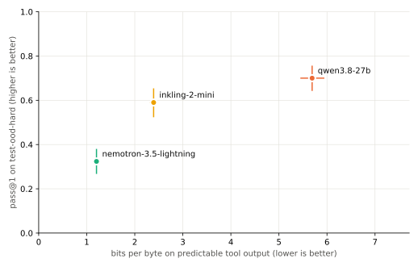

# Delta-Bench

Blog post: https://blog.munhou.com/Inkling-2-Mini-on-Delta-Lake/

Do models that predict tool outputs well also act well? This repository runs open models on
[Delta-World](https://github.com/munhouiani/delta_world), a simulated Databricks workspace with Delta
Lake tasks, and gives each model two scores:

- **Acting:** the share of rollouts whose final table state passes the verifier (pass@1).
- **Predicting:** how likely the model finds the real tool outputs, in bits per byte. Every model
  scores the same episodes, through its own chat template. Scores are per byte, so that models with
  different tokenizers compare.



| Model | pass@1, dev | pass@1, test-ood-hard | Bits per byte, predictable output | Bits per byte, all output |
|---|---|---|---|---|
| Inkling 2 Mini | 0.679 | 0.590 | 2.39 | 1.82 |
| Qwen3.8-27B | 0.721 | 0.700 | 5.69 | 5.29 |
| Nemotron 3.5 Lightning | 0.331 | 0.324 | 1.20 | 0.56 |

The model that predicts best acts worst. `results/` holds the tables with their 95% intervals. The
rollouts are on Hugging Face:
[delta-world-predicting-acting](https://huggingface.co/datasets/Sly6366/delta-world-predicting-acting).

Bits per byte here covers the 600 dev episodes these three models played. The dataset holds more
episodes, so scores over all of its likelihoods differ slightly.

## Setup

You need [uv](https://docs.astral.sh/uv/). Delta-World is a git submodule, so clone with
`--recurse-submodules`, or run `git submodule update --init` afterwards.

```bash
uv sync
uv run pytest
```

## The results, without a GPU

Download the published rollouts and rebuild the tables and the chart:

```bash
uvx hf download Sly6366/delta-world-predicting-acting --type dataset --include "traces/*" --include "likelihoods/*" --local-dir data/published
uv run python -m delta_bench.report --data data/published
```

## Running the models

The models and the simulator run on [Modal](https://modal.com). Sign in with `uv run modal setup`, then
create the secret that guards your vLLM server (Delta-World uses the same one):

```bash
uv run modal secret create delta-world-episodes DW_SERVICE_TOKEN=$(openssl rand -hex 32)
```

Start small. This runs 10 rollouts of one model, scores its first 5 episodes, and makes the tables:

```bash
MODEL=qwen3.8-27b uv run modal run -m modal_app.evaluate --splits dev --per-family 2 --samples 1 --data data/smoke
MODEL=qwen3.8-27b uv run modal run -m modal_app.score --limit 5 --data data/smoke
uv run python -m delta_bench.report --data data/smoke
```

Try each model in a `--data` directory of its own. Models that share one have to score the same episodes,
so evaluate all of them before you score any.

For the full experiment, leave the options out:

1. Run `modal_app.evaluate` for every model in `config.yaml`: 1,600 rollouts each, over both splits. One
   model took 40-60 minutes and $4-6 on an H100 in November 2026.
2. Then run `modal_app.score` for every model. They all score the same pool, so it needs every model's
   dev traces first.
3. Run `delta_bench.report`.

The server runs inside the evaluation's Modal app, so it stops when the run does. Delta-World's `test-id`
split was never run here.

## Adding a model

Add an entry to `models` in `config.yaml`. The model's card or its vLLM recipe has most of it:

- Find out which vLLM version loads it. If `serving.vllm_version` does not, set `image`.
- A hybrid model (Mamba or linear attention) needs `max_num_seqs`, and may need `enforce_eager` and no
  prefix caching.
- Check vLLM's log-probs against Transformers before you trust them. For Nemotron 3.5 Lightning, vLLM
  0.32.0 was 5.8% off in bits per byte, so it is scored with `scoring_engine: transformers`.
- Check `coverage` in `predicting.csv`. It should be close to the other models'. If it isn't, the
  tokenizers cut the predictable text too differently to compare.

## Layout

| Path | What it holds |
|---|---|
| `config.yaml` | Every setting, with one entry per model |
| `modal_app/evaluate.py` | Acting: the vLLM server, and Delta-World's harness against a simulator |
| `modal_app/score.py` | Predicting: the log-probs of the pool's tool outputs |
| `src/delta_bench/layout.py` | Which tokens of a rendered conversation are tool output |
| `src/delta_bench/bpb.py`, `acting.py` | The two scores, with bootstrap intervals |
| `src/delta_bench/report.py` | The tables and the chart |
| `third_party/delta_world` | Delta-World: the simulator, the tasks, the verifiers and the harness |

A data directory (`--data`) has the published dataset's layout: `traces/<model>-<split>.jsonl`,
`likelihoods/<model>.jsonl`, and `tables/`.

## License

Apache License 2.0; see [LICENSE](LICENSE) and [NOTICE](NOTICE). Delta-World is a separate work under the
same license. Each model's weights have their own license.
